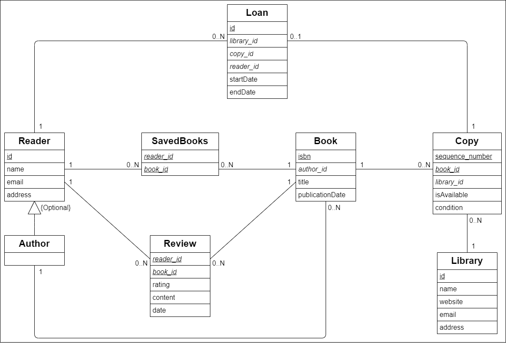

## Projectbeschrijving

Met deze applicatie kan je boeken opzoeken, reviews schrijven, boeken opslaan, boeken lenen en nog veel meer.

Er zijn drie soorten gebruikers: niet-ingelogde gebruikers, readers en authors.

- Een niet ingelogde gebruiker kan boeken opzoeken en reviews van boeken lezen. Het kan ook bibliotheken opzoeken en zien waar een bepaald boek beschikbaar is.
- Readers kunnen boeken opzoeken, reviews schrijven, boeken opslaan en boeken lenen.
- Authors kunnen boeken toevoegen en bewerken.
- De overige functionaliteiten zijn voorbehouden voor de admin.



## Vereisten

Ik verwacht dat volgende software reeds geïnstalleerd is:

- [NodeJS](https://nodejs.org)
- [Yarn](https://yarnpkg.com)
- [MySQL Community Server](https://dev.mysql.com/downloads/mysql/)

## Back-end

Maak een `.env` (development) of een `.env.test` (testing) bestand aan in de root van de back-end met volgende inhoud:

```plaintext
NODE_ENV=development
DATABASE_URL=mysql://<USERNAME>:<PASSWORD>@localhost:3306/<DATABASE_NAME>
AUTH_JWT_SECRET=<SECRET>
```

Vervang de variabelen met jouw eigen credentials.

### Opstarten

#### Development

- Corepack aanzetten: `corepack enable`
- Alle dependencies installeren: `yarn`
- Zorg dat het `.env` bestand correct is ingevuld
- Migraties uitvoeren: `yarn migrate:dev`
- Start de development server: `yarn start:dev`

#### Production

- Corepack aanzetten: `corepack enable`
- Alle dependencies installeren: `yarn`
- Zorg dat het `.env` bestand correct is ingevuld maar vervang development met production
- Migraties uitvoeren: `yarn prisma migrate deploy`
- Bouw het project: `yarn build`
- Start de productie server: `yarn start:prod`

### Testen

- Corepack aanzetten: `corepack enable`
- Alle dependencies installeren: `yarn`
- Zorg dat het `.env.test` bestand correct is ingevuld
- Migraties uitvoeren: `yarn migrate:test`
- Voer de testen uit: `yarn test`
  - Dit commando start een nieuwe server voor elke testsuite die wordt uitgevoerd, je ziet geen uitvoer omdat logging is uitgeschakeld.
  - De readerssuite duurt 'lang' (ongeveer 9s) om te voltooien, dit is normaal omdat er veel cryptografische bewerkingen worden uitgevoerd.
- Voer de testen uit met coverage: `yarn test:coverage`
  - Dit commando genereert een coverage rapport in de map `__tests__/coverage`.
  - Open `__tests__/coverage/lcov-report/index.html` in je browser om coverage rapport te bekijken.

## Projectstructuur

De applicatie bevind zich in het mapje `boekenclub` in mijn repository. De belangrijkste bestanden en mappen in de root van de applicatie zijn:

- `.env`: het configuratiebestand voor de applicatie
- `config`: de map met de configuratiebestanden voor de verschillende omgevingen
- `__test__`: de map met de testen van de applicatie
  - `coverage`: de map met de coverage rapporten van de testen
  - `rest`: de map met de testen van de REST-laag
- `src`: de map met de broncode van de applicatie
  - `rest`: de map met de REST-laag van de applicatie
  - `services`: de map met de servicelaag van de applicatie
  - `data`: de map met de datalaag van de applicatie
  - `core`: de map met belangrijke bestanden voor de applicatie

De applicatie is dus opgedeeld in de REST-laag, de servicelaag en de datalaag. De REST-laag bevat de routes van de applicatie, de servicelaag bevat de domeinlogica van de applicatie en de datalaag bevat de connectie met de databank.

## Logingegevens

### Reader

- Gebruikersnaam/e-mailadres: `hansvermeulen@email.com`
- Wachtwoord: `password1234`

### Author

- Gebruikersnaam/e-mailadres: `daanpeeters@email.com`
- Wachtwoord: `password1234`

### Admin

- Gebruikersnaam/e-mailadres: `anneliesvandenbogaert@email.com`
- Wachtwoord: `password1234`

## API calls

Swagger: <http://localhost:9000/swagger>

### Health

- `GET /api/health/ping`: ping de server
  - Kan ook voor niet ingelogde gebruikers
- `GET /api/health/version`: de versie van de server opvragen
  - Kan ook voor niet ingelogde gebruikers

### Reader

- `GET /api/readers`: alle lezers ophalen
  - Enkel voor admin
- `GET /api/readers/:id`: een bepaalde lezer ophalen
  - Enkel voor admin of de lezer zelf
- `POST /api/readers`: een lezer registreren
  - `{name, email, address, password}` meegeven
  - Kan ook voor niet ingelogde gebruikers
- `PUT /api/readers/:id`: een bepaalde lezer aanpassen
  - `{name, email, address}` meegeven
  - Enkel voor admin of de lezer zelf
- `DELETE /api/readers/:id`: een bepaalde lezer verwijderen
  - Enkel voor admin of de lezer zelf
- `GET /api/readers/:id/saved`: alle opgeslagen boeken van een bepaalde lezer ophalen
  - Enkel voor admin of de lezer zelf
- `POST /api/readers/:id/saved`: een bepaald boek opslaan, `{bookIsbn}` meegeven
  - Enkel voor admin of de lezer zelf
- `DELETE /api/readers/:id/saved/:isbn`: een opgeslagen boek van een bepaalde lezer verwijderen
  - Enkel voor admin of de lezer zelf
- `GET /api/readers/:id/reviews`: alle reviews van een bepaalde lezer ophalen
  - Enkel voor admin of de lezer zelf
- `POST /api/readers/:id/reviews`: een review toevoegen
  - `{bookIsbn, rating, content}` meegeven
- `PUT /api/readers/:id/reviews/:isbn`: een bepaalde review aanpassen
  - `{rating, content}` meegeven
  - Enkel voor admin of de lezer zelf
- `DELETE /api/readers/:id/reviews/:isbn`: een bepaalde review verwijderen
  - Enkel voor admin of de lezer zelf
- `GET /api/readers/:id/loans`: alle leningen van een bepaalde lezer ophalen
  - Enkel voor admin of de lezer zelf

### Author

- `GET /api/authors`: alle auteurs ophalen
  - Enkel voor admin
- `GET /api/authors/:id`: een auteur met een bepaald id ophalen
  - Enkel voor admin of de auteur zelf
- `POST /api/authors`: een nieuwe auteur toevoegen
  - `{readerId}` meegeven
  - Enkel voor admin
- `DELETE /api/authors/:id`: een auteur met een bepaald id verwijderen
  - Enkel voor admin of de auteur zelf
- `GET /api/authors/:id/books`: alle boeken van een bepaalde auteur ophalen
  - Enkel voor admin of de auteur zelf

### Book

- `GET /api/books`: alle boeken ophalen
  - Kan ook voor niet ingelogde gebruikers
- `GET /api/books/:isbn`: boek met een bepaald isbn ophalen
  - Kan ook voor niet ingelogde gebruikers
- `POST /api/books`: een nieuw boek toevoegen
  - `{isbn, title, publicationDate}` meegeven
  - Enkel voor authors
- `PUT /api/books/:isbn`: een bestaand boek met een bepaald isbn aanpassen
  - `{title, publicationDate}` meegeven
  - Enkel voor de auteur zelf
- `DELETE /api/books/:isbn`: een bestaand boek met een bepaald isbn verwijderen
  - Enkel voor admin of de auteur zelf
- `GET /api/books/suggest`: een willekeurig boek ophalen
  - Kan ook voor niet ingelogde gebruikers
- `GET /api/books/:isbn/reviews`: alle reviews van een bepaald boek ophalen
  - Kan ook voor niet ingelogde gebruikers
- `GET /api/books/:isbn/copies`: alle exemplaren van een bepaald boek ophalen
  - Kan ook voor niet ingelogde gebruikers

### Library

- `GET /api/libraries`: alle bibliotheken ophalen
  - Kan ook voor niet ingelogde gebruikers
- `GET /api/libraries/:id`: een bibliotheek met een bepaald id ophalen
  - Kan ook voor niet ingelogde gebruikers
- `POST /api/libraries`: een nieuwe bibliotheek toevoegen
  - `{name, website, email, address}` meegeven
  - Enkel voor admin
- `PUT /api/libraries/:id`: een bestaande bibliotheek met een bepaald id aanpassen
  - `{name, website, email, address}` meegeven
  - Enkel voor admin
- `DELETE /api/libraries/:id`: een bestaande bibliotheek met een bepaald id verwijderen
  - Enkel voor admin
- `GET /api/libraries/:id/copies`: alle exemplaren van alle boeken van een bepaalde bibliotheek ophalen
  - Kan ook voor niet ingelogde gebruikers
- `GET /api/libraries/available/:isbn`: alle bibliotheken waar een bepaald boek beschikbaar is
  - Kan ook voor niet ingelogde gebruikers
- `GET /api/libraries/:id/available/:isbn`: alle beschikbare exemplaren van een bepaald boek in een bepaalde bibliotheek ophalen
  - Kan ook voor niet ingelogde gebruikers

### Copy

- `POST /api/copies/:isbn`: een nieuw exemplaar toevoegen
  - `{libraryId, condition}` meegeven
  - Enkel voor admin
- `PUT /api/copies/:isbn/:id`: een bestaand exemplaar met een bepaald id aanpassen
  - `{libraryId, condition}` meegeven
  - Enkel voor admin
- `DELETE /api/copies/:isbn/:id`: een bestaand exemplaar met een bepaald id verwijderen, verwijder de loans
  - Enkel voor admin

### Loan

- `GET /api/loans`: alle leningen ophalen
  - Enkel voor admin
- `GET /api/loans/:id`: een lening met een bepaald id ophalen
  - Enkel voor admin
- `POST /api/loans`: een nieuwe lening toevoegen
  - `{copySeqNum, copyBookIsbn, readerId, startDate, endDate}` meegeven
  - Enkel voor admin
- `PUT /api/loans/:id`: een lening aanpassen
  - `{copySeqNum, copyBookIsbn, readerId, startDate, endDate}` meegeven
  - Enkel voor admin
- `DELETE /api/loans/:id`: een lening verwijderen
  - Enkel voor admin

### Session

- `POST /api/sessions`: inloggen
  - `{email, password}` meegeven
